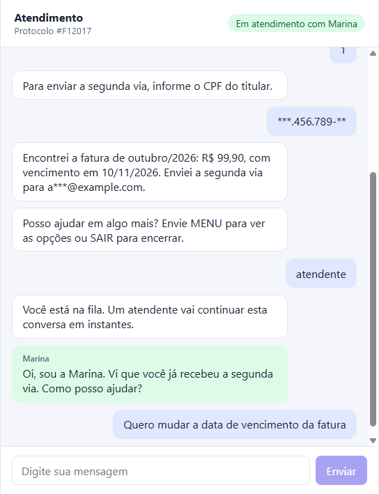
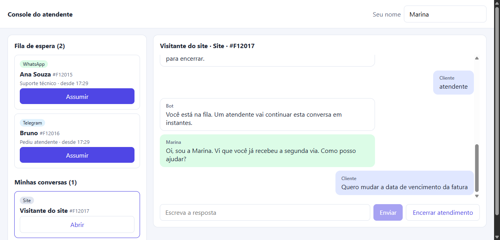
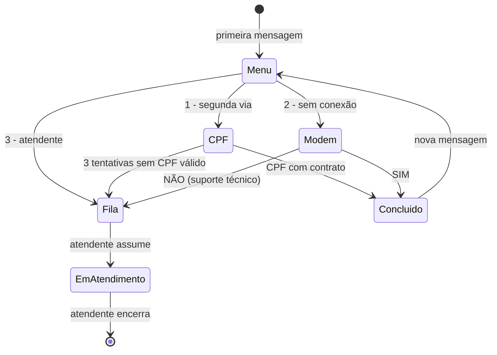

# ChatFlow · Chatbot omnichannel com testes em camadas

[](https://github.com/JVCSampaio/chatflow/actions/workflows/ci.yml)
· [Relatórios de testes](https://jvcsampaio.github.io/chatflow/)
· [Portfólio](https://github.com/JVCSampaio)

Chatbot de atendimento de um provedor de internet fictício, nos canais **WhatsApp** (formato da
Cloud API), **Telegram** e **webchat**, com transferência para **atendente humano**. Feito em
**Node.js + TypeScript**, **Express**, **MongoDB** e **React**. O foco do projeto é a qualidade:
cada risco é testado na camada em que o teste é mais rápido e confiável.

| Camada                  | Ferramenta                      | Resultado                                                            |
| ----------------------- | ------------------------------- | -------------------------------------------------------------------- |
| Unidade                 | Vitest                          | 96 testes do fluxo do bot, CPF, expediente, privacidade e canais     |
| API e banco             | Vitest + Supertest + MongoDB    | 70 testes de rotas, segurança, idempotência e concorrência           |
| Aceitação (BDD)         | Cucumber + Gherkin em português | 24 cenários, 166 passos                                              |
| API de fora para dentro | Postman + Newman                | 26 requisições, 82 asserções, JSON Schema e assinatura HMAC          |
| Ponta a ponta           | Selenium WebDriver + Chrome     | 3 testes, um deles com cliente e atendente em dois navegadores       |
| Cobertura               | V8                              | 99,7% das linhas e 96,7% dos ramos (mínimo exigido no CI: 95% e 90%) |

<p>
  
  
</p>

## O que o sistema faz



- **Bot:** menu, segunda via por CPF (dígitos verificadores conferidos), orientação para internet
  sem conexão e transferência depois de três respostas que ele não entende. Comandos `MENU`,
  `SAIR` e `ATENDENTE` valem em qualquer etapa; áudio e imagem recebem pedido de texto.
- **Canais:** cada canal tem um adaptador que valida o formato externo e o converte para um
  formato interno único. O WhatsApp confere a assinatura `X-Hub-Signature-256` (HMAC-SHA256) e
  responde à verificação do webhook; o Telegram confere o token secreto.
- **Idempotência:** reenvios do webhook (mesmo `wamid` ou `update_id`) são ignorados por um índice
  único no MongoDB, inclusive quando chegam ao mesmo tempo.
- **Atendimento humano:** fila por ordem de espera, aviso de fora do expediente (segunda a sexta,
  08h às 18h, horário de Brasília, configurável), atendente assume de forma atômica, responde
  e encerra. O webchat recebe as respostas por consulta periódica.
- **Privacidade (LGPD):** o histórico guarda o CPF como `***.456.789-**`, o e-mail aparece
  mascarado e os logs não registram o texto das mensagens nem o telefone completo.
- **Observabilidade:** logs em JSON com `X-Request-Id`, métricas no formato do Prometheus em
  `/metrics` (mensagens, duplicadas, transferências, encerramentos, duração HTTP) e `/health`.

## Testes

```gherkin
Cenário: Duas atendentes tentam assumir a mesma conversa
  Dado que estou conversando pelo canal "whatsapp"
  E que pedi para falar com um atendente
  Quando "Marina" e "Paula" tentam assumir a conversa ao mesmo tempo
  Então só uma delas fica com a conversa
  E a outra recebe o aviso "Esta conversa já está com"
```

Alguns testes que valem destacar:

- **Concorrência:** três respostas inválidas enviadas ao mesmo tempo precisam contar três
  tentativas e transferir o cliente. Sem a fila por contato, o teste falha (verificado com teste
  de mutação manual).
- **Segurança do webhook:** assinatura com outro segredo, corpo alterado depois de assinado e
  cabeçalho ausente são recusados com 401; o token do Telegram é conferido antes de ler o corpo.
- **Expediente com fuso:** limites às 07:59, 08:00, 17:59 e 18:00 em Brasília, calculados a partir
  de horários em UTC.
- **Falhas:** com o banco fora do ar, `/health` responde 503 e a API responde 500 genérico, com o
  erro registrado no log junto do id da requisição.
- **Navegador real:** o Selenium abre o webchat e o console, e a atendente assume a conversa pelo
  protocolo exibido ao cliente.

A estratégia completa, a rastreabilidade e os defeitos que os testes encontraram durante o
desenvolvimento estão em [docs/ESTRATEGIA_DE_TESTES.md](docs/ESTRATEGIA_DE_TESTES.md).
Os relatórios da última execução (BDD, Newman e cobertura) ficam no
[GitHub Pages](https://jvcsampaio.github.io/chatflow/).

## Executar

Requisitos: **Node.js 24** e, para os testes de ponta a ponta, **Google Chrome**. Não é preciso
instalar o MongoDB: sem `MONGO_URL`, a aplicação e os testes sobem um MongoDB temporário em memória.

```bash
npm ci
npm run build:web
npm start
```

Webchat em **http://localhost:3000** e console do atendente em **http://localhost:3000/atendente**.

| Comando                 | O que faz                                                              |
| ----------------------- | ---------------------------------------------------------------------- |
| `npm test`              | Testes de unidade e de API                                             |
| `npm run test:coverage` | Os mesmos testes, com cobertura mínima                                 |
| `npm run test:bdd`      | Cenários Cucumber                                                      |
| `npm run e2e`           | Compila a interface, sobe o servidor de teste e roda Newman e Selenium |
| `npm run lint`          | Prettier e verificação de tipos                                        |

Com Docker, `docker compose up --build` sobe a aplicação e o MongoDB 8. A coleção
`postman/chatflow.postman_collection.json` pode ser importada no Postman com o ambiente
`postman/local.postman_environment.json`.

## Decisões

- **Fluxo do bot como função pura:** `decidir(estado, mensagem, contexto)` não acessa banco nem
  rede, então cada transição é testada isoladamente; o serviço de atendimento só grava o resultado.
- **Relógio injetado:** o expediente é testado com datas fixas, sem depender da hora da execução.
- **Concorrência em duas camadas:** dentro do processo, mensagens do mesmo contato são processadas
  em fila; entre instâncias, índices únicos parciais impedem conversa e mensagem duplicadas.
- **Assumir conversa de forma atômica:** `findOneAndUpdate` só altera se o status ainda for
  "aguardando"; quem chega depois recebe 409.
- **Erros padronizados:** `{ erro, detalhes }` em português, com o campo inválido indicado.
- **TypeScript sem build no servidor:** o Node 24 executa os arquivos `.ts` diretamente
  (type stripping); só a interface React passa pelo Vite.

## Estrutura

```text
src/
  bot/            fluxo (função pura), CPF, expediente, mensagens, clientes fictícios
  canais/         adaptadores do WhatsApp, Telegram e webchat
  atendimento.ts  regras de recebimento, transferência e ações do atendente
  repositorio.ts  MongoDB e índices
  app.ts          rotas HTTP, logs, métricas e tratamento de erros
web/              webchat e console do atendente (React + Vite)
tests/            unidade e API (Vitest + Supertest)
features/         cenários BDD em português (Cucumber)
postman/          coleção e ambiente do Postman
e2e/              Selenium com Page Objects
```

## Limites

O envio das respostas para o WhatsApp e o Telegram é simulado: as mensagens são gravadas, sem
chamar as APIs da Meta e do Telegram. O console do atendente não tem autenticação. O expediente
não considera feriados. A ordem das mensagens de um mesmo contato é garantida dentro de uma
instância; com várias instâncias, seria preciso uma fila particionada por contato. Não foram
feitos testes de carga. Os clientes e CPFs são fictícios (exemplos clássicos de validação).

Licença [MIT](LICENSE).
